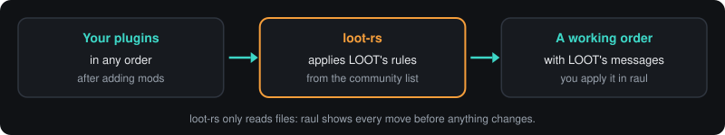
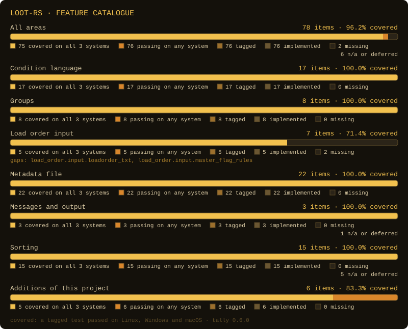
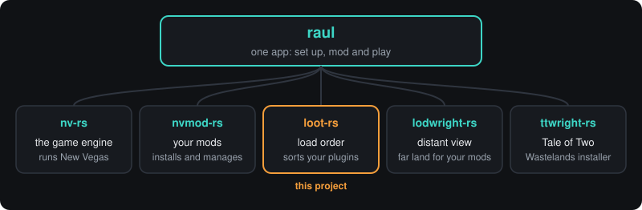

# loot-rs

**loot-rs puts the mods of Fallout: New Vegas and Tale of Two Wastelands in a working load order.** Mods are loaded
one after another, and in the wrong order they can break each other or crash the game. loot-rs sorts them with the
rules the [LOOT](https://loot.github.io/) community keeps for many mods.

  

## What you see

loot-rs sorts the **Load order** page of [raul](https://github.com/JorisJonkers-dev/rauls-trusty-toolbox). raul shows
every move and LOOT's messages first, and changes nothing until you press Apply.

  
  

## What it does for you

- 🔢 **Sorts your mods** the way LOOT does, on Linux, Windows and macOS.
- 💬 **Warns you** with LOOT's messages: a missing file a mod needs, two mods that do not go together.
- 👀 **Only reads, never writes**: you decide what happens with the order.

## How far along it is

Every LOOT feature on the list, and how many are built and tested. The picture updates itself after each change.

  

## How it fits together

  

loot-rs is one part of raul. As its own project it is tested on its own: on 3,300 made-up load orders it sorted
exactly as LOOT's own sorter does ([docs/ORACLE.md](docs/ORACLE.md)).

## Get it

**[Download raul](https://github.com/JorisJonkers-dev/rauls-trusty-toolbox/releases/latest)**: loot-rs is built in.
It also works on its own as a library and from the command line ([docs/USAGE.md](docs/USAGE.md)).

## Learn more

- [Using loot-rs](docs/USAGE.md): raul's Load order page, the library, the commands, what it does not do, downloads.
- [More detail](docs/OVERVIEW.md): licence and origin, design notes, how it was tested, open questions.
- [Every LOOT feature and its state](docs/COMPATIBILITY.md).

An independent port, not an official LOOT project. Licence: GPL-3.0, the licence of LOOT
([details and origin](docs/OVERVIEW.md#licence-and-origin), [NOTICE.md](NOTICE.md)).
